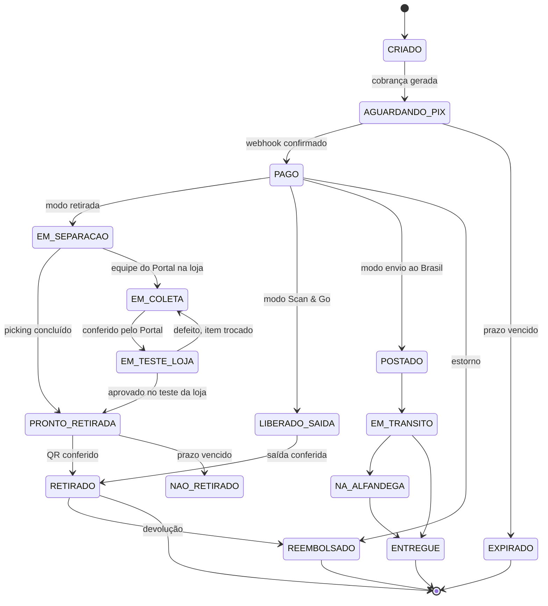

# Portal Paraguai · Pick & Go — Especificação técnica e de engenharia

Versão 0.1 · 17/10/2026 · Documento para a equipe de implementação

> Convenções: **[DECISÃO]** marca ponto em aberto que precisa de resposta do negócio ou do jurídico antes do desenvolvimento. **[SUGESTÃO]** marca escolha técnica proposta, que a equipe pode trocar com justificativa. Valores, percentuais e nomes de exemplo são ilustrativos.
> As telas citadas (T1 a T29) são as do canvas "Portal Paraguai Pick & Go".

---

## 1. Visão geral

### 1.1 Objetivo
Permitir que o turista brasileiro compre nas lojas do Portal Paraguai (80+ lojistas em Ciudad del Este) **antes de chegar** ou **dentro da loja**, pague por **Pix** sem passar pelo caixa e receba a compra por um destes caminhos:

1. **Retirada com picking prévio** na loja ou na área de retirada do Portal Paraguai.
2. **Scan & Go**: compra dentro da loja, com conferência de saída digital (QR) ou física.
3. **Envio ao Brasil** (opcional).

O produto evolui o "Compras no Paraguai" (hoje só mostra preços) para um fluxo de compra completo, com carteira (cashback e bônus), CRM, campanhas e painéis para a loja e para a plataforma.

### 1.2 Atores
| Ator | Descrição |
|---|---|
| Turista (cliente) | Brasileiro, identificado por CPF, usa o app ou a página web |
| Lojista | Gerencia catálogo, pedidos, retirada, campanhas e vê vendas e comissão |
| Operador de retirada / conferência | Separa pedidos e libera a saída (tablet ou celular) |
| Central de operação do Portal | Equipe do Portal Paraguai responsável por picking, conferência de QR, entrega ao cliente e checagem de Pick & Go (T30) |
| Atendente (customer care) | Atende por WhatsApp, app e e-mail no CRM |
| Administrador do Portal Paraguai | Gerencia lojas, comissões, campanhas e vê o painel da plataforma |
| EPYX | Parceiro que recebe o split e processa a liquidação [DECISÃO: papel exato] |

### 1.3 Escopo por fase
| Fase | Entrega | Telas |
|---|---|---|
| 1 | Catálogo, sacola, Pix, retirada com QR, painel da loja, conferência | T1 a T7, T9, T30 |
| 2 | Scan & Go, carteira, painel da plataforma, KYC, notificações do pedido | T5, T8, T10 a T13, T19 |
| 3 | CRM, campanhas, Data Hub, ativação multicanal | T14, T15, T16, T17, T18, T29 |
| 4 | Vídeo com compra em 1 clique, envio ao Brasil | T20 a T28 |

---

## 2. Premissas e decisões em aberto

| # | Decisão | Impacto |
|---|---|---|
| D1 | **Quem recebe o Pix** e como a conversão para dólar e o repasse às lojas funcionam (lojas com conta em dólar, Pix via Câmbio Real) | Arquitetura de pagamentos e ledger |
| D2 | **Base legal e consentimento** do turista para KYC, enriquecimento de dados e mensagens (LGPD e, no Paraguai, a lei local) | Modelo de consentimento, retenção |
| D3 | **Cota de compras por terra** (referência de US$ 500 por pessoa, regra de 2020) e tributação para itens de valor alto | Regras de checkout e avisos |
| D4 | **Percentuais**: comissão do Portal, split da EPYX, quem paga bônus e cashback | Motor de regras de comissão |
| D5 | **Scan & Go**: quem assume o risco de furto e como é a conferência de saída | Fluxo de saída e antifraude |
| D6 | **Pedido com várias lojas**: uma retirada ou uma por loja | Modelo de pedido e picking |
| D7 | **Envio ao Brasil**: transportadora, rastreio por API e responsável pelo desembaraço | Módulo de envio |
| D8 | **Data Hub (Wangari Carbon / SalesBox)**: contratação para o Portal e quais APIs usar | Módulo de enriquecimento |
| D9 | **Provedores** de WhatsApp, RCS, push e e-mail | Módulo de ativação |
| D10 | **Construir ou integrar** o CRM | Módulos de CRM e atendimento |
| D11 | **Central de operação do Portal** — **definido:** o Portal coleta os itens na loja; o ponto de retirada fica na própria loja ou anexo a ela; piloto com 5 lojas e 10 pessoas em turno único das 8h às 18h; a taxa de serviço está dentro da comissão do Portal; perdas e divergências são entre a loja e o Portal conforme o caso. **Regra de ocorrências:** ver 3.3.2 | Fulfillment, ocorrências e comissão |

---

## 3. Requisitos funcionais

### 3.1 Catálogo e compra (T1, T2)
- **RF-01** Listar produtos por loja e categoria, com preço, estoque e foto.
- **RF-02** Sacola com itens de várias lojas [DECISÃO D6].
- **RF-03** Escolher o modo de entrega: retirar na loja, retirar na área do Portal ou enviar ao Brasil.
- **RF-04** Configurador de produto (ex.: bicicleta com aro 26, 29 ou 31, cor branco, preto, azul ou vermelho e acessórios como selim de gel, freios ABS, adesivos e amortecedores), com preço por opção (T27).
- **RF-05** Aviso de cota e tributação conforme regras vigentes [D3].

### 3.2 Pagamento (T3, T24)
- **RF-06** Gerar cobrança Pix com QR e código copia-e-cola, com validade configurável.
- **RF-07** Confirmar pagamento por webhook, de forma idempotente.
- **RF-08** Dividir o valor na liquidação: loja, Portal Paraguai e EPYX (T25, T28) [D4].
- **RF-09** Estorno total ou parcial com reversão do split.
- **RF-10** Compra em 1 clique para cliente com Pix salvo e cadastro completo (T21).

### 3.3 Retirada e saída (T4 a T7)
- **RF-11** Pedido pago gera ordem de picking para a loja ou para a área do Portal.
- **RF-12** Cliente vê o status e o QR de retirada; "Avisar que cheguei".
- **RF-13** Conferência: operador lê o QR e libera a saída (T7).
- **RF-14** Scan & Go: cliente escaneia o item na loja, paga por Pix e recebe QR de saída (T5, T6).
- **RF-15** Divergência na conferência abre ocorrência (item faltante, item a mais).

### 3.3.1 Central de operação do Portal (T30)
- **RF-42** Fila de picking da central, com pedidos de várias lojas e etapas: a separar, separado, pronto para entrega, entregue.
- **RF-43** Coleta dos itens na loja pela equipe do Portal, com tarefa de coleta, conferência na saída da loja e registro de quem coletou.
- **RF-44** Conferência de QR e entrega ao cliente, com conferência de documento quando exigida e registro do operador.
- **RF-45** Checagem de Pick & Go na saída, por amostragem ou total, com abertura de ocorrência em divergência.
- **RF-46** A taxa de serviço da operação está incluída na comissão do Portal: não há cobrança separada; o ledger registra só a comissão e o split [D4].
- **RF-48** Ocorrências com tipo, responsável e resolução, conforme a regra 3.3.2, e lançamento do ajuste na fatura de repasse.
- **RF-50** Teste e análise de defeitos: após a conferência do Portal, o item segue ao canal de teste e análise de defeitos da loja; a loja registra o resultado (aprovado, defeito, troca) antes da liberação ao cliente.
- **RF-49** Ponto de retirada configurável por loja (dentro da loja ou anexo), com horário de funcionamento, por padrão das 8h às 18h no piloto.
- **RF-47** Indicadores da central: fila, tempo de separação, tempo até a entrega, ocorrências e pedidos não retirados.

### 3.3.2 Regra de responsabilidade por ocorrência
| Situação | Responsável | Resolução no sistema |
|---|---|---|
| Item com defeito detectado no teste da loja, antes da saída | Loja | Troca do item; pedido segue ao ponto de retirada |
| Defeito ou reclamação **depois que o cliente sai da loja** | Loja | O CRM abre o ticket e encaminha à loja; sem ônus ao Portal |
| Item faltante | Loja e Portal | Acerto na fatura de repasse **ou** reposição na loja, completando o pedido |
| Item a mais | Loja e Portal | Acerto na fatura de repasse **ou** devolução e reposição, completando o pedido |
| Divergência na conferência de saída (Pick & Go) | Conforme o caso | Ocorrência com responsável registrado e ajuste na fatura |

Regras: o marco da mudança de responsabilidade é o registro de saída do cliente da loja (conferência de QR concluída); toda ocorrência guarda quem, quando, tipo, responsável e resolução; ajustes na fatura geram lançamentos no ledger, nunca alteração de lançamento antigo. O que falta definir é o prazo de garantia e o fluxo de devolução, que ficam com a loja.

### 3.4 Envio ao Brasil (T19)
- **RF-16** Cotar frete e prazo, gerar etiqueta e registrar código de rastreio [D7].
- **RF-17** Atualizar status (postado, em trânsito, na alfândega, entregue) e notificar o cliente.

### 3.5 Cadastro e KYC (T11 a T13)
- **RF-18** Cadastro com CPF, nome, WhatsApp e e-mail, com aceite explícito dos termos e das mensagens.
- **RF-19** KYC por documento e selfie, com análise e status (aprovado, pendente, recusado) [D2].
- **RF-20** Validação de identidade e qualidade de contato pelo Data Hub, quando contratado [D8].

### 3.6 Carteira, cashback e rewards (T8)
- **RF-21** Saldo em reais, separado em cashback e bônus promocional, com extrato.
- **RF-22** Crédito automático após a retirada confirmada, conforme a regra da campanha.
- **RF-23** Níveis de rewards por número de compras, com benefícios [DECISÃO: regras].
- **RF-24** Uso do saldo como desconto no checkout; expiração configurável.

### 3.7 Painéis (T9, T10, T28)
- **RF-25** Painel da loja: vendas brutas, comissão do Portal, líquido, pedidos por modo.
- **RF-26** Painel da plataforma: vendas, comissões do Portal, split da EPYX, por loja e por origem de campanha.
- **RF-27** Exportação de relatórios e conciliação com o extrato do Pix.

### 3.8 Campanhas (T14, T15, T16)
- **RF-28** Tipos: item adicional, cashback e cupom de desconto (código PICKGO-xxxx).
- **RF-29** Definir quem paga o bônus (loja, Portal ou dividido), público, validade e limite de uso.
- **RF-30** Recomendação de campanhas por IA, com calendário de datas e previsão de queda de movimento (T16).
- **RF-31** Origem da venda rastreada por código de campanha, vídeo e produto.

### 3.9 CRM e atendimento (T17, T18)
- **RF-32** Fila única de atendimento com WhatsApp, app e e-mail, e contexto do pedido e do cliente.
- **RF-33** Ações do atendente: enviar instruções, reenviar QR, confirmar retirada, ver rastreio, creditar cashback (com alçada e auditoria).
- **RF-34** Jornadas automáticas por evento do pedido, cupom e carteira.
- **RF-35** Venda ativa: sugerir oferta ao cliente durante o atendimento.

### 3.10 Ativação multicanal (T29)
- **RF-36** Cascata de canais: push, WhatsApp, RCS e e-mail, com prazo de espera entre eles.
- **RF-37** Respeitar aceite e pedido de parar de receber; limite semanal de mensagens por cliente.
- **RF-38** Métricas por campanha: enviadas, entregues, abertas, cliques, compras e receita.

### 3.11 Vídeo e link inteligente (T20 a T22)
- **RF-39** Cada produto do vídeo tem um link curto com código de vídeo e de produto.
- **RF-40** Com o app instalado, o link abre direto no produto (deep link); sem o app, abre a página web com Pix.
- **RF-41** Página web com cadastro mínimo (CPF e WhatsApp) na primeira compra e convite para instalar o app.

---

## 7. Máquina de estados do pedido

---

## 14.2 Critérios de aceite (exemplos)
- **Pix:** um pagamento recebido duas vezes pelo webhook gera um único lançamento no ledger.
- **Split:** em uma venda de R$ 60.000,00 com 90/7/3, os lançamentos somam R$ 54.000,00, R$ 4.200,00 e R$ 1.800,00, e a soma é igual ao valor pago.
- **Retirada:** um QR já usado não libera uma segunda retirada.
- **Ocorrências:** item faltante gera acerto na fatura ou reposição que fecha o pedido; defeito reclamado depois da saída abre ticket encaminhado à loja, sem lançamento contra o Portal.
- **Estorno:** estornar um pedido reverte o split e o cashback creditado.
- **Mensagens:** cliente sem aceite não recebe nenhuma mensagem; cliente que pediu para parar é excluído da cascata em até [__] minutos.
- **Link inteligente:** o mesmo link abre o app se instalado e a página web se não; o pedido registra o vídeo e o produto de origem.
- **Atendimento:** toda ação do atendente que mexe em dinheiro tem registro de quem fez e quando.
